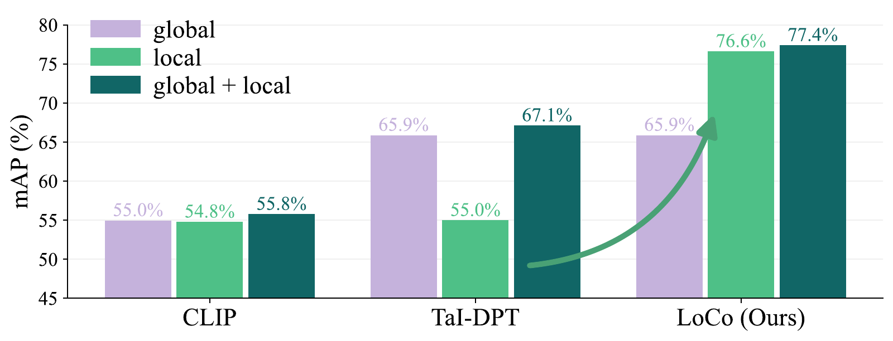
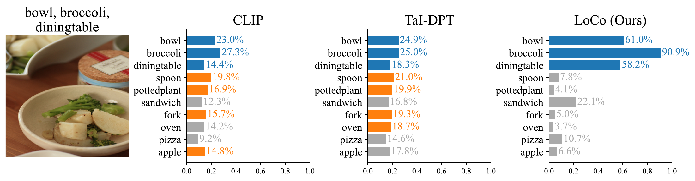
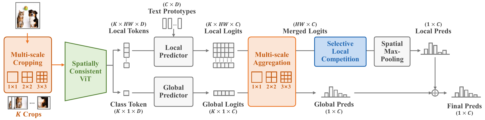

<h1 align="center">LoCo: Selective Local Competition for Discriminative Open-Vocabulary Multi-Label Recognition</h1>

<p align="center">
  Zhuoming Li<sup>1</sup> · Bo Han<sup>1</sup> · Xiaoyu Wang<sup>2</sup> · Yuheng Jia<sup>1,3,*</sup>
</p>

<p align="center">
  <sup>1</sup>School of Computer Science and Engineering, Southeast University, Nanjing, China<br>
  <sup>2</sup>School of Software Engineering, Southeast University, Nanjing, China<br>
  <sup>3</sup>Key Laboratory of New Generation Artificial Intelligence Technology and Its Interdisciplinary Applications<br>
  (Southeast University), Ministry of Education, China<br>
  <sup>*</sup>Corresponding author
</p>

<p align="center">
  
  
  
</p>

<p align="center">
  <a href="#overview">Overview</a> ·
  <a href="#installation">Installation</a> ·
  <a href="#quick-start">Quick Start</a> ·
  <a href="#bibtex">BibTeX</a>
</p>

<p align="center">
  
</p>
<p align="center"><em>LoCo unleashes the potential of local prediction for open-vocabulary multi-label recognition.</em></p>

<p align="center">
  
</p>
<p align="center"><em>LoCo produces more discriminative multi-label prediction scores.</em></p>

**LoCo** is a training-free framework for open-vocabulary multi-label recognition. It combines spatially consistent local visual features with **Selective Softmax**, introducing competition between incompatible categories while preserving compatible concepts. Multi-scale inference captures evidence at different scales, and optional ensembling incorporates predictions from an existing global predictor.

## Overview

<p align="center">
  
</p>

LoCo uses a spatially consistent visual encoder to obtain reliable local features. Selective Softmax makes each category compete only with locally incompatible categories. Multi-scale crop logits are aligned and averaged before Selective Softmax and spatial max pooling, yielding image-level local predictions that can optionally be ensembled with global predictions.

## Installation

Use Python 3.10. From the project directory, install PyTorch for your hardware and the remaining dependencies:

```bash
# NVIDIA GPU, CUDA 11.8 build
python -m pip install torch==2.6.0 torchvision==0.21.0 --index-url https://download.pytorch.org/whl/cu118
python -m pip install -r requirements.txt
```

For CPU, replace `cu118` with `cpu` and add `device=cpu amp=false` to the evaluation command.

## Quick Start

Prepare COCO 2014 validation images under `coco2014/val2014/` and annotations at `coco2014/annotations/instances_val2014.json`. The COCO text prototypes are included. Run full COCO evaluation from the project directory:

```bash
python loco_standalone.py dataset=coco2014 dataset_root=/path/to/dataset downsample_ratio=1.0
```

`dataset_root` is the parent of `coco2014` and defaults to `~/dataset`. Use `downsample_ratio=1.0` to evaluate the full test split.

## BibTeX

If you use LoCo in your research, please cite:

```bibtex
@inproceedings{li2026loco,
  title     = {{LoCo}: Selective Local Competition for Discriminative Open-Vocabulary Multi-Label Recognition},
  author    = {Zhuoming Li and Bo Han and Xiaoyu Wang and Yuheng Jia},
  booktitle = {Advances in Neural Information Processing Systems},
  year      = {2026}
}
```
